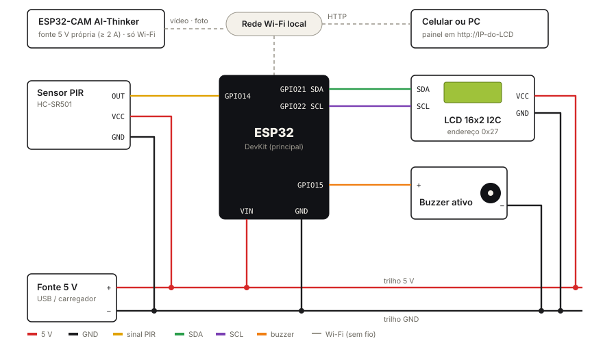

# RASTRO

**Instalação interativa sobre vigilância com ESP32 e ESP32-CAM**
Projeto Integrador em Computação · Mostra PIC 2026

Arthur Gabriel de Souza Costa · Lucas Grillo Lyra · Frederino José de Castro

---

## Sobre o projeto

Somos registrados o tempo todo: câmeras em lojas e ruas, catracas que contam quem entra, celulares que guardam onde estivemos. Quase sempre sem perceber e sem autorizar.

O **RASTRO** é um objeto que faz o contrário: em vez de esconder a vigilância, ele a **mostra**. Um sensor de presença detecta quem passa, o objeto reage com som e mensagem no LCD, uma câmera registra a cena e tudo aparece na hora em uma página web aberta ao público, com horário, foto e histórico de cada passagem.

A referência artística é *Under Scan* (2005), de Rafael Lozano-Hemmer, obra em que um sistema de rastreamento detecta pedestres e revela, de tempos em tempos, a própria estrutura de vigilância. O RASTRO faz isso em escala pequena: detectar quem passa e revelar o registro.

## Como funciona

```
 Sensor PIR ──GPIO 14──►  ESP32 principal  ◄──Wi-Fi──► Navegador (celular ou PC)
                          · lógica e estados              · painel em tempo real
 LCD 16x2 ◄──I2C────────  · histórico (100 eventos)       · vídeo ao vivo
 Buzzer   ◄──GPIO 15────  · servidor web (porta 80)       · fotos salvas no navegador
                                   ▲
 Servidor NTP ──Wi-Fi──────────────┘ (hora certa)

 ESP32-CAM (CameraWebServer) ──Wi-Fi──► vídeo :81/stream · foto :80/capture
```

1. **Passa:** o sensor PIR detecta movimento.
2. **É visto:** o buzzer toca (até 15 s) e o LCD mostra `MOVIMENTO!`.
3. **É registrado:** o ESP32 grava o evento com data e hora (NTP).
4. **É fotografado:** o painel pede uma foto à ESP32-CAM no mesmo instante.
5. **Se encontra:** quem abre o painel pelo IP do LCD vê o vídeo, o horário e a foto da própria passagem.

## Hardware

| Componente | Pinos do componente | Ligação |
|---|---|---|
| ESP32 DevKit (principal) | – | alimentação 5 V pelo USB/VIN |
| Sensor PIR HC-SR501 | VCC / OUT / GND | VIN (5 V) / GPIO 14 / GND |
| LCD 16x2 com módulo I2C (0x27) | VCC / GND / SDA / SCL | VIN / GND / GPIO 21 / GPIO 22 |
| Buzzer ativo | + / − | GPIO 15 / GND |
| ESP32-CAM AI-Thinker (OV2640) | – | fonte 5 V própria (≥ 2 A), apenas Wi-Fi |
| Protoboard, jumpers, fonte 5 V | – | GND em comum |

**Cores dos fios:** vermelho = 5 V · preto = GND · amarelo = sinal do PIR · verde/roxo = SDA/SCL · laranja = buzzer.

## Esquemático



O ESP32 principal e a ESP32-CAM não têm fios entre si: comunicam-se só pela rede Wi-Fi. A montagem também pode ser aberta no simulador Wokwi com o arquivo [`docs/wokwi/diagram.json`](docs/wokwi/).

## Estrutura do repositório

```
esp32_principal/
  esp32_principal.ino   firmware do ESP32 principal (PIR, buzzer, LCD, servidor web)
  pagina.h              painel web (HTML/CSS/JS embutido no firmware)
  config.exemplo.h      modelo de configuração de Wi-Fi e IP da câmera
CameraWebServer/
  CameraWebServer.ino   firmware da ESP32-CAM (baseado no exemplo oficial da Espressif)
  app_httpd.cpp         servidor de vídeo (/stream) e foto (/capture)
  board_config.h        modelo da câmera (AI-Thinker)
  config.exemplo.h      modelo de configuração de Wi-Fi
docs/
  esquematico.svg       esquemático simplificado
  wokwi/diagram.json    montagem para o simulador Wokwi
```

## Como montar e rodar

### 1. Preparar o Arduino IDE
- Instale o pacote de placas **esp32 by Espressif Systems** (Gerenciador de Placas).
- Instale a biblioteca **LiquidCrystal I2C** (Frank de Brabander).

### 2. Configurar a rede
Em cada pasta, copie `config.exemplo.h` para `config.h` e preencha o nome e a senha do Wi-Fi.
O `config.h` está no `.gitignore` e **nunca vai para o GitHub**.

### 3. Gravar a ESP32-CAM
- Placa: **AI Thinker ESP32-CAM** · PSRAM: *Enabled* · Partition: *Huge APP (3MB No OTA)*.
- Grave `CameraWebServer/CameraWebServer.ino` e abra o Monitor Serial (115200).
- Anote o IP de `Camera Ready! Use 'http://...'` e coloque em `CAM_IP_PADRAO` no `config.h` do principal.

### 4. Gravar o ESP32 principal
- Placa: **ESP32 Dev Module**. Grave `esp32_principal/esp32_principal.ino`.
- O LCD mostra `Calibrando PIR` por 30 s e depois o IP na segunda linha (o IP também sai no Monitor Serial).

### 5. Abrir o painel
No celular ou PC **na mesma rede Wi-Fi**, abra `http://<IP do LCD>`.
Para ver a interface sem a placa, abra a página com `?demo` no fim do endereço.

## O painel web

- Estado da vigilância (ligada/pausada), do sensor e contagem de passagens.
- Vídeo ao vivo da ESP32-CAM e foto automática a cada novo movimento, mais o botão de foto manual.
- Sirene manual (15 s) e opção de disparo automático ao detectar.
- Histórico dos últimos 100 eventos com busca, filtros e exportação em CSV.
- Saúde do dispositivo: sinal Wi-Fi, memória livre e tempo ligado.
- Detecta reinício da placa e perda de conexão ("dados desatualizados").

### Rotas HTTP do ESP32 principal

| Rota | Método | Retorno |
|---|---|---|
| `/` | GET | painel web |
| `/status` | GET | JSON com estado, hora, último movimento, sinal, memória |
| `/eventos` | GET | JSON com os últimos 100 eventos |
| `/cmd` | POST | `c=arm\|sirene\|automatico`, `v=0\|1` — altera o estado |

O painel consulta `/status` e `/eventos` a cada 1,5 s.

## Ética e privacidade

O RASTRO fala de vigilância e, nesta versão, também filma. Por isso definimos limites que fazem parte da obra:

- **Tudo é local:** vídeo e fotos não saem da rede do evento; nada é enviado para a internet (a única conexão externa é o NTP, para a hora).
- **Sem identificação:** o sensor detecta movimento, não pessoas; não há reconhecimento facial, nomes ou dados do celular.
- **Memória curta:** o histórico da placa (100 eventos) é apagado ao reiniciar; as fotos ficam só no navegador do painel (até 60) e são apagadas ao fim da Mostra.
- **Aviso visível:** a instalação é sinalizada como área filmada.

## Limitações conhecidas

- A foto é tirada alguns instantes **depois** da detecção (latência da rede) e só com o painel aberto.
- A ESP32-CAM transmite vídeo para **um navegador por vez**.
- Sem internet, a hora aparece como "Sem horário sincronizado".
- Os comandos (armar, sirene) não têm senha: qualquer pessoa na mesma rede pode usá-los.
- Redes de universidade costumam bloquear a comunicação entre aparelhos; o plano B é o roteador do celular.

## Próximos passos

- Gravar fotos no cartão microSD da ESP32-CAM, sem depender do navegador aberto.
- Histórico persistente (LittleFS ou servidor local) e gráfico de movimentos por hora.
- QR code impresso na instalação para o público abrir o painel.

## Referências

- Rafael Lozano-Hemmer, *Under Scan* (2005).
- Espressif, exemplo CameraWebServer: https://github.com/espressif/arduino-esp32/tree/master/libraries/ESP32/examples/Camera/CameraWebServer

## Vídeo

Demonstração no YouTube: _[inserir link]_
