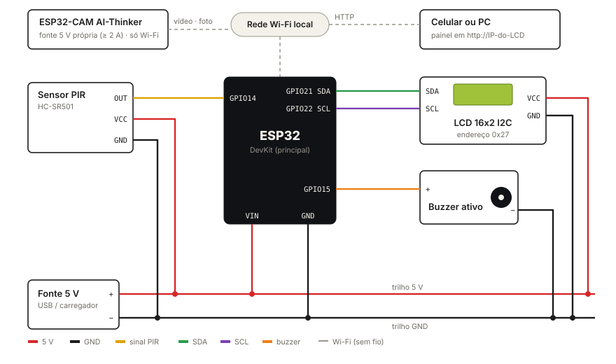

# RASTRO

**Instalação interativa sobre vigilância com ESP32 e ESP32-CAM**
Projeto Integrador em Computação · Mostra PIC · UFES · 2026

Arthur Gabriel de Souza Costa · Lucas Grillo Lyra · Frederino José de Castro

▶ **Vídeo de apresentação:** https://youtu.be/TmanoaxNWUU

---

## Resumo

Instalação interativa que expõe a vigilância cotidiana: um ESP32 com sensor PIR detecta quem passa, reage com som e LCD e mostra cada registro, com foto da ESP32-CAM, em uma página web aberta ao público em tempo real.

## Sumário

1. [Conceito](#conceito)
2. [Como funciona](#como-funciona)
3. [Hardware e ligações](#hardware-e-ligações)
4. [Esquemático](#esquemático)
5. [Software](#software)
6. [Dependências](#dependências)
7. [Como montar, gravar e rodar](#como-montar-gravar-e-rodar)
8. [Usando o painel](#usando-o-painel)
9. [API HTTP](#api-http)
10. [Estrutura do repositório](#estrutura-do-repositório)
11. [Ética e privacidade](#ética-e-privacidade)
12. [Limitações conhecidas](#limitações-conhecidas)
13. [Solução de problemas](#solução-de-problemas)
14. [Modificações em relação à proposta original](#modificações-em-relação-à-proposta-original)
15. [Referências](#referências)

---

## Conceito

Somos registrados o tempo todo: câmeras em lojas e ruas, catracas que contam quem entra, celulares que guardam onde estivemos. Quase sempre sem perceber e sem autorizar.

O **RASTRO** faz o contrário: em vez de esconder a vigilância, ele a **mostra**. Um sensor de presença detecta quem passa, o objeto reage com som e mensagem no LCD, uma câmera fotografa a cena e tudo aparece na hora em uma página web aberta ao público, com horário, fotos e histórico de cada passagem. Quem é registrado pode ver o próprio registro.

A referência artística é *Under Scan* (2005), de Rafael Lozano-Hemmer, obra em que um sistema de rastreamento detecta pedestres e revela ao público a própria estrutura de vigilância.

## Como funciona

```
 Sensor PIR ──GPIO 14──►  ESP32 principal              ◄──HTTP──►  Navegador (celular/PC)
                          · agrupa ocorrências                     · painel em tempo real
 LCD 16x2  ◄──I2C───────  · modos e programação noturna            · vídeo ao vivo
 Buzzer    ◄──GPIO 15───  · histórico na flash (100 eventos)       · álbuns de fotos (IndexedDB)
                          · servidor web (porta 80)                        │
 Servidor NTP ──Wi-Fi──►  (hora certa, UTC−3)                              │
                                                                           ▼
 ESP32-CAM (CameraWebServer) ──Wi-Fi──► vídeo :81/stream · foto /capture · /status
```

O que o visitante vive:

1. **Passa:** o sensor PIR detecta o movimento.
2. **É visto:** o LCD mostra `MOVIMENTO!` e o buzzer reage conforme o modo (silêncio, toque curto ou sirene de até 8 s).
3. **É registrado:** o ESP32 agrupa os sinais do PIR em uma **ocorrência** e a grava na memória flash com data e hora obtidas por NTP.
4. **É fotografado:** com o painel aberto, cada ocorrência gera um álbum de até 5 fotos da ESP32-CAM.
5. **Se encontra:** pelo IP mostrado no LCD, o visitante abre o painel no celular e vê o vídeo ao vivo, o horário e as fotos da própria passagem.

### Ocorrências

O PIR liga e desliga várias vezes enquanto alguém está por perto. Para não gerar dezenas de registros, o firmware agrupa sinais próximos em uma única ocorrência (`ocorrencia.h`):

- a primeira subida do sinal **abre** a ocorrência;
- novas subidas em menos de **10 s** somam detecções à mesma ocorrência;
- depois de 10 s sem sinal, a ocorrência é **encerrada**.

O contador principal do painel conta ocorrências, não pessoas: o PIR detecta movimento e não identifica ninguém.

### Modos de operação

| Modo | Registro e fotos | Som ao iniciar uma ocorrência |
|---|---|---|
| **Monitoramento** | sim | nenhum |
| **Ausente** | sim | sirene de até 8 s |
| **Apresentação** | sim | toque de 250 ms |

O modo e o estado de pausa ficam salvos na flash e voltam depois de reiniciar.

### Programação noturna

O painel permite programar uma faixa diária (padrão sugerido: **22:00 às 07:00**) em que a placa entra sozinha no modo Ausente; fora da faixa ela usa o modo diurno escolhido (Monitoramento ou Apresentação). A troca roda na própria placa, mesmo com o navegador fechado. Uma troca manual vale até a próxima virada de horário. A programação respeita a pausa e espera o relógio sincronizar via NTP. Em uma placa nova ela começa desativada.

### Histórico persistente

Os últimos **100 eventos** ficam na partição `rastro_data` da flash (NVS), cada um em um bloco de 64 bytes com versão e CRC32 (`historico.h`, `persistencia.h`). Criação e encerramento de ocorrências são gravados em até ~2 s; uma ocorrência ativa é salva a cada 30 s. Uma ocorrência que estava aberta quando a energia caiu volta marcada como "interrompida". As fotos não ficam na placa: ficam no navegador que estava com o painel aberto.

## Hardware e ligações

### Lista de componentes

| Qtd | Componente | Função | Ligação |
|---|---|---|---|
| 1 | ESP32 DevKit (ESP32-WROOM-32) | controlador principal, Wi-Fi e servidor web | USB ou VIN 5 V |
| 1 | ESP32-CAM AI-Thinker (OV2640, com PSRAM) | vídeo ao vivo e fotos | 5 V e GND · só Wi-Fi |
| 1 | Sensor de presença PIR HC-SR501 | detecta movimento | VCC → VIN (5 V) · OUT → GPIO 14 · GND |
| 1 | Display LCD 16x2 com módulo I2C (0x27) | estado, modo e IP do painel | SDA → GPIO 21 · SCL → GPIO 22 · VCC → VIN · GND |
| 1 | Buzzer ativo | som conforme o modo | + → GPIO 15 · − → GND |
| 1 | Protoboard | montagem e trilhos de 5 V e GND | – |
| ≈20 | Jumpers macho-macho e macho-fêmea | ligações | – |
| 1–2 | Fonte 5 V USB (≥ 2 A para a câmera) | alimentação | GND em comum |

**Cores dos fios no esquemático:** vermelho = 5 V · preto = GND · amarelo = sinal do PIR · verde/roxo = SDA/SCL · laranja = buzzer.

### Gravação da ESP32-CAM

A ESP32-CAM não tem USB. Para gravar, use um adaptador **ESP32-CAM-MB** ou o próprio ESP32 principal como ponte USB-serial:

- EN do ESP32 principal no GND (mantém o principal em reset);
- TX do principal → U0T da câmera e RX do principal → U0R da câmera (ponte direta, não cruzada);
- GPIO0 da câmera no GND durante a gravação;
- depois de gravar, retire esses fios, solte o GPIO0 e o EN e reinicie as placas.

No uso normal a câmera fica só com 5 V e GND: **a comunicação entre as duas placas é toda pelo Wi-Fi.**

## Esquemático



O circuito do ESP32 principal também pode ser aberto no simulador Wokwi com [`docs/wokwi/diagram.json`](docs/wokwi/) (instruções em [`docs/wokwi/README.md`](docs/wokwi/README.md)). O Wokwi não tem ESP32-CAM.

### Gabinete para impressão 3D

A pasta [`gabinete/`](gabinete/) tem uma caixa de parede ou de mesa em forma de olho: a cúpula do PIR é a pupila, a lente da câmera fica acima e o LCD embaixo. Inclui o modelo paramétrico em OpenSCAD (`rastro_gabinete.scad`) e um script em Python (`build_case.py`) que gera os arquivos STL.

## Software

### ESP32 principal (`esp32_principal/`)

| Arquivo | Conteúdo |
|---|---|
| `esp32_principal.ino` | programa principal: leitura do PIR, buzzer, LCD (em tarefa FreeRTOS separada), Wi-Fi, NTP, servidor HTTP, comandos, modos, programação noturna e busca automática da câmera |
| `ocorrencia.h` | agrupador de ocorrências (janela de 10 s) |
| `modos.h` | modos de operação, duração do som e controle da sirene |
| `noturno.h` | programação noturna (faixa de horário, ajuste manual, gravação com CRC) |
| `historico.h` | estrutura `Evento` e formato de 64 bytes com CRC32 |
| `persistencia.h` | leitura e gravação do histórico na flash (Preferences/NVS) |
| `migracao_memoria.h` | migração do histórico da NVS padrão para a partição `rastro_data` |
| `historico_inicial.h` | semente opcional de histórico (vazia nesta versão pública) |
| `pagina.h` | painel web completo (HTML, CSS e JavaScript) guardado na flash |
| `pagina_http.h` | envio da página em partes, trocando `__CAM__` pelo IP da câmera |
| `partitions.csv` | tabela de partições com app de 3 MB e a partição `rastro_data` (64 KB) |
| `config.exemplo.h` | modelo de configuração (Wi-Fi e IP da câmera) |

### ESP32-CAM (`CameraWebServer/`)

Baseado no exemplo **CameraWebServer** da Espressif, com ajustes do RASTRO: JPEG QVGA 320×240, dois buffers na PSRAM com `CAMERA_GRAB_LATEST`, XCLK reduzido para 8 MHz depois de iniciar o sensor, `TCP_NODELAY` no servidor e detector de brownout desligado. O painel troca a compressão JPEG pela rota `/control` (perfil "Mais fluido" = JPEG 40, "Mais nítido" = JPEG 14).

### Painel web (`esp32_principal/pagina.h`)

Página única servida pelo ESP32 principal. Consulta `/status` a cada 1,5 s e `/eventos` só quando o histórico muda, mostra o vídeo direto da ESP32-CAM e guarda as fotos no **IndexedDB** do navegador. Tem modo de demonstração sem placa: abra a página com `?demo` no endereço.

Um guia de estudo do código, com explicação de cada parte, está em [`docs/guia/GUIA-COMPLETO-RASTRO.md`](docs/guia/GUIA-COMPLETO-RASTRO.md), e o mapa de todas as funções com links para as linhas está em [`docs/guia/MAPA-DO-CODIGO.md`](docs/guia/MAPA-DO-CODIGO.md).

## Dependências

| Item | Versão usada / observação |
|---|---|
| Arduino IDE | 2.x |
| Pacote de placas **esp32 by Espressif Systems** | **3.3.12** (Gerenciador de Placas) |
| Biblioteca **LiquidCrystal I2C** (Frank de Brabander) | Gerenciador de Bibliotecas |
| Bibliotecas incluídas no pacote esp32 | `WiFi`, `WebServer`, `Wire`, `Preferences`, `esp_camera`, FreeRTOS |
| Rede Wi-Fi **2,4 GHz** | as duas placas e o celular/PC na mesma rede, com comunicação entre aparelhos permitida |
| Navegador moderno | Chrome, Edge, Firefox ou Safari (usa IndexedDB, `fetch` e `<dialog>`) |
| Opcional: OpenSCAD ou Python 3 com NumPy | para gerar os STL do gabinete |

Configuração de placa no Arduino IDE:

| | ESP32 principal | ESP32-CAM |
|---|---|---|
| Placa | ESP32 Dev Module | ESP32 Dev Module (pinagem AI-Thinker já escolhida em `board_config.h`) |
| Partition Scheme | Huge APP (3MB No OTA/1MB SPIFFS) | Huge APP (3MB No OTA/1MB SPIFFS) |
| PSRAM | **Disabled** | **Enabled** |
| Tabela de partições | o `partitions.csv` da pasta é usado automaticamente | o `partitions.csv` da pasta é usado automaticamente |
| Monitor Serial | 115200 baud | 115200 baud |

## Como montar, gravar e rodar

1. **Monte o circuito** conforme a tabela de ligações e o esquemático. Ligue todos os GND juntos.
2. **Configure a rede:** em `esp32_principal/` e em `CameraWebServer/`, copie `config.exemplo.h` para `config.h` e preencha o nome e a senha do Wi-Fi (2,4 GHz). O `config.h` está no `.gitignore` e **não vai para o GitHub**.
3. **Grave a ESP32-CAM:** abra `CameraWebServer/CameraWebServer.ino`, use as configurações da tabela acima (PSRAM *Enabled*) e grave. No Monitor Serial, anote o IP mostrado.
4. **Informe o IP da câmera:** coloque esse IP em `CAM_IP_PADRAO` no `esp32_principal/config.h`. Se a câmera mudar de IP, o principal a procura sozinho na sub-rede (testa `/status` de cada endereço).
5. **Grave o ESP32 principal:** abra `esp32_principal/esp32_principal.ino` com **todos** os arquivos da pasta juntos (os `.h` e o `partitions.csv`), PSRAM *Disabled*, e grave.
6. **Espere a calibração:** o LCD mostra `Calibrando PIR` por 30 s e depois o modo e o IP do painel na segunda linha (o IP também aparece no Monitor Serial).
7. **Abra o painel:** em um celular ou PC na mesma rede, acesse `http://<IP do LCD>`.
8. **Primeiro uso:** a placa começa em Monitoramento com o registro pausado. Clique em **Retomar registro**, escolha o modo e, se quiser, ative a programação noturna.

> Não use **Erase All Flash** ao regravar uma placa já em uso: isso apaga o histórico e as configurações guardadas na NVS.

## Usando o painel

- **Estado:** vigilância ligada/pausada, sensor (calibrando, alguém passou, ninguém à vista), número de ocorrências e horário do último rastro.
- **Controles:** pausar/retomar registro, seletor de modo, teste/silêncio do som e programação noturna.
- **Câmera:** vídeo ao vivo, perfis "Mais fluido"/"Mais nítido", pausa do vídeo, tela cheia e reconexão automática (se o vídeo travar, o painel passa para fotos em sequência e tenta voltar ao vídeo depois).
- **Fotos:** álbum de até 5 fotos por ocorrência, tiradas automaticamente com o painel aberto e visível, mais foto manual; limite de 300 fotos por navegador. A sequência pode ser reproduzida como um álbum.
- **Histórico:** 25 registros por página, busca, filtros por tipo, fotos e datas, resumo com gráfico de ocorrências por hora e exportação em CSV.
- **Backup:** baixa um arquivo JSON com fotos e registros e restaura em outro navegador ou IP.
- **Saúde do dispositivo:** sinal Wi-Fi, memória livre, tempo ligado, estado do LCD e do salvamento do histórico.

## API HTTP

### ESP32 principal (porta 80)

| Rota | Método | Descrição |
|---|---|---|
| `/` | GET | painel web |
| `/status` | GET | JSON com sessão, hora, modo, pausa, sirene, sensor, contadores, revisão do histórico, IP da câmera, Wi-Fi, memória, LCD e programação noturna |
| `/eventos` | GET | JSON com os eventos guardados (até 100) |
| `/cmd` | POST | `c=modo&v=monitoramento\|ausente\|apresentacao` |
| | | `c=arm&v=0\|1` (pausa/retoma o registro) |
| | | `c=sirene&v=0\|1` (silencia/testa o som do modo) |
| | | `c=noturno&v=0\|1&inicio=HH:MM&fim=HH:MM&dia=monitoramento\|apresentacao` |

Respostas de erro vêm como `{"erro": "..."}` com código 400, 409 ou 503.

### ESP32-CAM

| Rota | Descrição |
|---|---|
| `:81/stream` | vídeo MJPEG |
| `/capture` | uma foto JPEG |
| `/status` | configuração da câmera (usada para encontrá-la na rede) |
| `/control?var=...&val=...` | ajustes (qualidade JPEG, resolução etc.) |

## Estrutura do repositório

```
esp32_principal/        firmware do ESP32 principal e painel web
CameraWebServer/        firmware da ESP32-CAM
gabinete/               gabinete para impressão 3D (OpenSCAD + gerador de STL)
docs/
  esquematico.svg       esquemático simplificado
  wokwi/                montagem do ESP32 principal para o simulador Wokwi
  guia/                 guia de estudo, mapa do código e roteiro da apresentação
  desenvolvimento/      notas de cada etapa de desenvolvimento e validação
```

## Ética e privacidade

O RASTRO fala de vigilância e também filma. Por isso os limites abaixo fazem parte da obra:

- **Tudo é local:** vídeo e fotos não saem da rede do evento; nada é enviado para a internet. A única conexão externa é o NTP, para a hora.
- **Sem identificação:** o sensor detecta movimento, não pessoas. Não há reconhecimento facial, nomes ou dados do celular.
- **Memória limitada:** a placa guarda só os últimos 100 eventos (os mais antigos são substituídos) e as fotos ficam apenas no navegador do painel, sem cópia automática em servidor.
- **Aviso visível:** a instalação é sinalizada como área filmada.
- Este repositório não contém senhas, fotos nem registros reais de uso.

## Limitações conhecidas

- As fotos automáticas dependem do painel **aberto e visível** em algum navegador; a placa não guarda imagens.
- A ESP32-CAM sustenta bem **uma transmissão de vídeo por vez**; com outro espectador o painel usa fotos em sequência.
- A taxa de quadros varia com a cena, a luz e a rede; não há FPS garantido. Não há visão noturna por infravermelho.
- Sem NTP, os eventos aparecem como "Sem horário sincronizado" e a programação noturna espera o relógio.
- Os comandos não têm senha: qualquer pessoa na mesma rede pode usá-los.
- Redes de universidade costumam bloquear a comunicação entre aparelhos; o plano B é um roteador ou o hotspot do celular em 2,4 GHz.
- Não é um equipamento de segurança certificado.

## Solução de problemas

| Sintoma | O que verificar |
|---|---|
| Monitor Serial só mostra pontos / "Wi-Fi caiu, motivo 201" | rede não encontrada: confira o nome e se é 2,4 GHz |
| "motivo 15" ou "202" | senha errada no `config.h` |
| `Camera init failed` | encaixe do cabo da câmera, modelo AI-Thinker e fonte 5 V forte |
| Painel abre, câmera não | `CAM_IP_PADRAO`, mesma rede nas duas placas e isolamento de clientes no roteador |
| LCD apagado ou sem texto | endereço I2C (0x27), SDA/SCL e contraste do módulo |
| PIR dispara demais | ajuste os potenciômetros de sensibilidade e tempo do HC-SR501 |
| Histórico não volta após reiniciar | grave com o `partitions.csv` da pasta e sem Erase All Flash |

## Modificações em relação à proposta original

| Aspecto | Proposta original | Versão final |
|---|---|---|
| Câmera | nenhuma imagem guardada | ESP32-CAM com vídeo ao vivo e álbum de até 5 fotos por ocorrência |
| Sinalização | LEDs + buzzer + LCD | LCD (estado, modo e IP) + buzzer; LEDs retirados |
| Página web | lista pública de horários, QR code, botão "apagar meu registro" | painel com vídeo, álbuns, filtros, resumo por hora, CSV, backup e saúde do dispositivo |
| Comunicação | WebSocket | rotas HTTP consultadas a cada 1,5 s |
| Armazenamento | LittleFS | 100 eventos na NVS (partição própria), fotos no navegador |
| Modos | um único comportamento | Monitoramento, Ausente e Apresentação, com programação noturna |
| Robustez | não previsto | calibração do PIR, reconexão do Wi-Fi e do vídeo, câmera encontrada sozinha na rede |

## Referências

- Rafael Lozano-Hemmer, *Under Scan* (2005).
- Espressif, exemplo CameraWebServer: https://github.com/espressif/arduino-esp32/tree/master/libraries/ESP32/examples/Camera/CameraWebServer
- Espressif, documentação do Arduino-ESP32: https://docs.espressif.com/projects/arduino-esp32/

Os arquivos herdados do exemplo CameraWebServer mantêm seus comentários e créditos originais (licença Apache 2.0 da Espressif).
